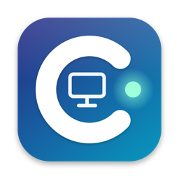
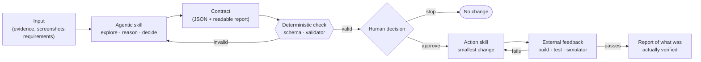
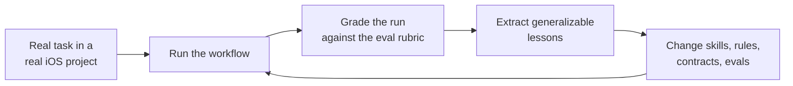

# ios-agentic-toolkit

A growing toolkit of supervised agentic workflows for real iOS engineering
work, packaged as a [Claude Code](https://docs.claude.com/en/docs/claude-code)
plugin.

This is not an iOS app and not one giant autonomous agent. It is a set of
engineering rules, skills, contracts, deterministic tools and evaluations that
Claude Code uses **inside your own iOS repositories**. Each workflow covers one
area of iOS work: crash investigation, UI implementation, release preparation
and so on. A workflow is added only when a real use case needs it, and it is
refined by grading real runs.

## Workflows

| Workflow | What it does | Status |
|---|---|---|
| [Crash Investigation & Fix](docs/workflows/crash-investigation.md) | Read-only Crashlytics investigation with ranked, evidence-backed hypotheses, followed by an approval-gated minimal fix and honest verification | **Implemented**, refined in real use |
| [Design System](docs/workflows/design-system.md) | Reference screenshots + your direction → original design-system contract, generated SwiftUI tokens and a rendered specimen | **Implemented**, refined in real use |
| [App Migration](docs/workflows/app-migration.md) | Deterministic baseline from code + parallel area agents + independent verification → complete, verified feature inventory; validated as-is flow specs and a decision log; an independent audit; port preparation for a legacy app | **Implemented**, refined by an audit of a real run |
| [App Port](docs/workflows/app-port.md) | Verbatim, build-error-driven port of a legacy app's code and assets into a new app; then the view layer rebuilt on the new design system by parallel restyle agents, gated by a legacy-styling report and a human screenshot review; a final parity gate checks every inventoried feature against the legacy app | **Implemented**, derived from a real port |
| [SwiftUI UI Implementation](docs/workflows/ui-implementation.md) | New screens on the design-system contract and generated tokens, inside the existing architecture: an approved element → token plan, then a deterministic token-usage gate, the build and simulator screenshots | **Implemented**, derived from a real port |
| Visual Review | Compares implemented UI with design-system rules and feeds violations back to implementation | Planned |
| App Store Metadata | Description, subtitle, keywords and review notes | Planned |
| App Review Assistant | Prepares responses to App Review | Planned |
| Release Precheck | Pre-submission checks | Planned |
| iOS Bug Triage | Structured triage of bug reports | Planned |
| Firebase/APNs Configuration Audit | Configuration checks | Planned |
| Legacy Feature Change Safety | Safe changes in large legacy codebases | Planned |

Planned items are ideas, not features. Each will be designed when a real task
needs it.

## Tools

Small native apps for the environment iOS work runs in. Each does a
deterministic job that needs permissions or secrets a model should not hold,
and comes with a thin skill so Claude Code can trigger it.

| Tool | What it does | Status |
|---|---|---|
|  [VNCBar](docs/tools/vnc-bar.md) | Menu bar app: one click connects to a remote Mac over Screen Sharing, gets through its dialogs and logs in; passwords stay in the Keychain. The `remote-mac` skill triggers it. | **Implemented**, used daily |

## Principles

- **Hybrid deterministic + agentic.** Behavior that can be specified reliably
  is a script, schema or validator. Agentic reasoning is used only where
  judgment is needed: interpreting incomplete evidence, exploring unfamiliar
  code, deciding what to inspect next, forming and ranking hypotheses.
- **Supervised autonomy.** Read-only and analysis steps may run on their own.
  Changing code requires an explicit request and an approved plan, and risky
  or broad changes require confirmation.
- **Evidence over plausibility.** Observations, inferences, hypotheses and
  confirmed facts are kept apart. "Insufficient evidence" is a valid outcome,
  and "it compiles" is never reported as "it is fixed".
- **Earned complexity.** No agents, subagents, MCP servers or LLM calls are
  added because they are possible. Each must justify itself, and the
  justification is documented.
- **Evaluated, not demoed.** Every workflow has a rubric, and real runs are
  graded against it.

## Building blocks

| Concept | Meaning | Where |
|---|---|---|
| **Rule** | A domain-independent engineering constraint shared by all workflows | [`rules/`](rules/ios-engineering.md) |
| **Skill** | Knowledge and procedure for one task, loaded on demand | [`skills/<name>/SKILL.md`](skills/) |
| **Agent / subagent** | A separate reasoning context, used only when isolation or focus clearly pays off | Parallel area agents and independent verifiers in [App Migration](docs/workflows/app-migration.md#design-decisions); parallel restyle agents in [App Port](docs/workflows/app-port.md#design-decisions) |
| **Contract** | Structured output that a later step, human or eval consumes | [`schemas/`](schemas/) |
| **Tool** | A deterministic program the agent runs and observes | [`scripts/`](scripts/), native apps in [`tools/`](tools/), `xcodebuild`, `simctl`, `git` |
| **Workflow** | Skills, deterministic steps and human decisions put together for one area of work | [`docs/workflows/`](docs/workflows/) |
| **Eval** | Rubric and fixtures that measure a workflow's behavior | [`evals/`](evals/) |

## Anatomy of a workflow

Workflows share a shape: agentic work that produces a contract, deterministic
checks on that contract, a human decision before anything changes, and
external feedback before anything is called done.



Not every workflow needs every stage. A read-only workflow ends at the
contract, for example. But new workflows start from this shape rather than
from a blank page.

## How the toolkit grows



Real projects and their data stay private. Only sanitized lessons and
synthetic examples enter this repository. The crash workflow's
[lessons from real use](docs/workflows/crash-investigation.md#lessons-from-real-use)
show this loop in practice.

## Installation

In any iOS repository:

```
/plugin marketplace add rcanbaba/ios-agentic-toolkit
/plugin install ios-agentic-toolkit@ios-agentic-toolkit
```

While developing the toolkit, load a local checkout instead:

```sh
cd ~/path/to/your-ios-app
claude --plugin-dir ~/path/to/ios-agentic-toolkit
```

Usage is described per workflow; start with
[Crash Investigation & Fix](docs/workflows/crash-investigation.md#usage).

## Repository structure

```
.claude-plugin/        plugin + marketplace manifests
rules/                 shared, domain-independent engineering rules
skills/<name>/         one folder per skill (SKILL.md + on-demand references)
schemas/               contracts between steps
scripts/               deterministic tools
tools/<name>/          native apps (Swift packages) with their build scripts
docs/workflows/        one document per workflow: design, usage, decisions, lessons
docs/tools/            one document per tool
examples/<area>/       synthetic inputs and expected outputs
evals/<skill>/         rubrics and fixture plans
```

## Safety and privacy

This repository is public. It never contains company source code, real crash
reports, user identifiers, production stack traces, Firebase configuration,
service-account files or keys. Examples and eval fixtures are synthetic.
Workflow outputs are written inside the target repository, in git-excluded
locations.

## License

[MIT](LICENSE)
