# Workflow: App Divergence

**Status:** implemented, derived from a real fork · **Skill:** [`app-divergence`](../../skills/app-divergence/SKILL.md) · **Scripts:** [`rename_identifiers.py`](../../scripts/rename_identifiers.py), [`verify_rename.py`](../../scripts/verify_rename.py), [`check_split.py`](../../scripts/check_split.py), [`find_string_bindings.py`](../../scripts/find_string_bindings.py), [`similarity.py`](../../scripts/similarity.py) · **Eval:** [`evals/app-divergence`](../../evals/app-divergence/README.md)

Turns a fork into its own codebase. After [App Port](app-port.md), the new
app behaves like the original because it carries the original's code. This
workflow gives it its own vocabulary and structure, phase by phase, while
the behavior and the wire format stay exactly the same, and measures how
much of the original is still in it.

## Why

A product line of apps on one backend (a rebrand, a regional variant, a
white-label app) starts as a port. Left alone, the fork stays a copy:
the original's names in every file, its folder layout, its one-off
structure. Changing that by hand across a thousand files is where behavior
gets lost, because nobody can review 3,500 renames by eye.

So each kind of change gets a proof that fits it:

| Change | Proof |
|---|---|
| Rename | `verify_rename.py`: only mapped tokens changed, same line count, same strings, against a copy taken before |
| Rename (what the compiler cannot see) | `find_string_bindings.py`: every xib class, plist class, `NSClassFromString` and string-loaded asset still resolves |
| File split | `check_split.py`: the same members, headers, top-level code and strings, with relaxed access listed |
| Refactor | independent reviewers compare every method with the baseline |
| Rewrite | a differential test: old and new side by side on the same inputs under several locales and time zones |
| Progress | `similarity.py`: overlap with the original without pairing files, raw and with renames reversed |

## Architecture

```mermaid
flowchart TD
    P["Ported fork<br/>(App Port done, parity gate green)"] --> V{"Human: vocabulary<br/>banned words · wire boundary"}
    V --> PH["Phase: one area"]
    PH --> BL["Baseline copy"]
    BL --> MAP["Rename map<br/>rename · protected · banned"]
    MAP --> RI{{"rename_identifiers.py<br/>refuses collisions,<br/>protected and banned names"}}
    RI --> MV["Move files and folders to match"]
    MV --> VR{{"verify_rename.py<br/>only mapped tokens changed"}}
    VR --> SB{{"find_string_bindings.py<br/>xib · plist · NSClassFromString · assets"}}
    SB --> B["Build"]
    B --> SP["Split large files"]
    SP --> CS{{"check_split.py<br/>same members and strings"}}
    CS --> RA["Refactor agents (parallel, no builds)"]
    RA --> I["Integrate · build once"]
    I --> RV["Independent equivalence reviewers<br/>on a frozen copy"]
    RV -- different --> RA
    RV -- equivalent --> SM["Simulator smoke<br/>(DEBUG launch arguments)"]
    SM --> M{{"similarity.py<br/>raw · normalized · by kind · by area"}}
    M --> L["Ledger: maps, results,<br/>pre-existing bugs (not fixed)"]
    L --> H{"Human: next area,<br/>or enough"}
    H -- next --> PH
    H -- network layer --> BE["Backend rename list<br/>paths · events · actions · scopes"]
    BE --> RAW["Case names new, raw values old;<br/>switch raw values when the backend ships"]
    RAW --> ID{"Identity checklist"}
```



## Stages

| # | Stage | Who | Output |
|---|---|---|---|
| 1 | Vocabulary, banned words, wire boundary | orchestrator proposes, **human picks** | vocabulary table, `protected` lists |
| 2 | Rename phase per area: baseline, map, apply, move files, verify, bindings, build | orchestrator + deterministic | `renames/NN-area.json`, ledger entry |
| 3 | Split large files by concern | orchestrator + deterministic | `Type+Concern.swift` files, split report |
| 4 | Refactor by parallel agents; independent reviewers; differential tests for rewrites | agents + reviewers, **human** decides pre-existing bugs | refactored area, review verdicts, ledger bug list |
| 5 | Measure after each phase | deterministic | similarity report |
| 6 | Explain the floor; choose the next lever or stop | orchestrator + **human** | decision |
| 7 | Backend rename list; case names new, raw values old; switch when the backend ships | orchestrator + backend owner | `endpoint-socket-rename.{md,json}` |
| 8 | Identity checklist | **human** with console access | shipped identity |

## Deterministic vs agentic responsibilities

| Responsibility | Approach |
|---|---|
| Choosing the vocabulary and banned words | **Human**, from the agent's proposals |
| Which Swift names are wire names | **Agentic** reading of the models, recorded as `protected`; enforced **deterministically** |
| Applying a rename without touching strings; refusing collisions | **Deterministic** (`rename_identifiers.py`) |
| Proving a rename changed only names | **Deterministic** (`verify_rename.py`) |
| References by string after a rename or a port | **Deterministic** (`find_string_bindings.py`) |
| Proving a split moved code only | **Deterministic** (`check_split.py`) |
| Restructuring code | **Agentic** (parallel agents under strict rules) |
| Judging that a refactor is equivalent | **Agentic**, by independent reviewers who did not write it |
| Equivalence of a rewrite | **Deterministic** differential test, built per case |
| Fixing a pre-existing bug | **Human** decides, separately from the phase |
| How similar the fork still is, and why | **Deterministic** (`similarity.py`); what is enough is the **human**'s call |

## Usage

```
/app-divergence vocabulary
/app-divergence rename chat
/app-divergence refactor profile view models
/app-divergence measure
/app-divergence backend
/app-divergence identity
```

Scripts by hand:

```sh
python3 scripts/rename_identifiers.py Porting/renames/05-chat.json --src App --dry-run
python3 scripts/verify_rename.py Porting/renames/05-chat.json --src App --baseline <baseline>/App
python3 scripts/find_string_bindings.py --src App --catalog App/Resources/Assets.xcassets
python3 scripts/check_split.py --baseline <copy>/PlayerViewModel.swift --parts App/Player/PlayerViewModel*.swift
python3 scripts/similarity.py --original <original>/App --fork App --renames Porting/renames/*.json --md similarity.md
evals/app-divergence/run.sh
```

## Measured in the real run

One fork of a large production app (about 950 Swift files), 18 days,
about 30 phases:

| What moved | Count |
|---|---|
| Identifier renames (34 maps) | ~3,500 |
| Localization keys renamed to `feature.screen.element` | 1,318 |
| Endpoint paths / socket events / socket actions | 311 / 127 / 9 |
| Network model types | 654 |

| Similarity (no file pairing) | Start | End |
|---|---|---|
| Raw line overlap | ~62 % | 52.2 % |
| Raw fingerprint overlap | | 46.2 % |
| Normalized (renames reversed) line / fingerprint | | 67.9 % / 61.3 % |

Of the remaining 52 points: ~23 generic lines every Swift app shares, ~12
wire field names (model properties, CodingKeys and the feature code that
reads them), ~17 carried-over logic, concentrated in the streaming, network
and utility areas. Reviewers found dozens of pre-existing bugs (unbounded
indexes, inverted conditions, swallowed errors, a selection keyed by a
random id); all were recorded, and fixed only where the user decided to.

## Design decisions

- **Rename before restructure, network last.** A rename is mechanical and
  verifiable; a restructure needs reviewers. Doing names first makes every
  later diff smaller. Network model names reach into feature code, so they
  move once, after the backend agreed the names.
- **Strings are untouchable by construction.** The rename tool lexes Swift
  and never edits inside a literal, and the verifier compares the string
  multiset of the whole tree; that is how the wire format stayed
  byte-identical through ~3,500 renames.
- **Refuse, don't guess.** A new name that already exists in a file, a
  protected name in a map, a banned word or a one-letter name stops the
  rename before anything is written.
- **Verify against a copy, not git.** Phases often span several commits, or
  none yet; a baseline copy works either way, and file moves are matched by
  reversing the map in the path.
- **The compiler is not the last check.** xib classes, plist classes and
  string-loaded assets break at runtime only; a scan after every rename
  phase replaces "found on a device".
- **Writers don't review.** Refactor agents and reviewers are separate
  agents; the reviewer works on a frozen copy and compares method by method.
  One reviewer caught a placeholder that would have stalled history loading.
- **Bugs are recorded, not fixed.** A refactor that also fixes bugs cannot
  be reviewed for equivalence. The ledger holds them for the user.
- **Pairing-free similarity.** A file-pair metric reported 22 % while half
  the lines were still the original's; whole-tree line and fingerprint
  overlap, raw and normalized, tells what the renames bought and what is
  still shared logic.
- **Backend names as data.** Endpoint and socket cases take the new names
  while their raw values keep the old strings, so the backend switch is a
  raw-value change from one JSON file.

## Lessons from real use

| Observed in a real run | Change |
|---|---|
| A Swift class was renamed, its xib kept the old `customClass`; the nib built a plain view and a forced cast crashed when the user opened the screen | `find_string_bindings.py` after every rename phase |
| 55 icons loaded with `Image("name")` were never copied in the port; panels drew empty boxes with no error | String-loaded asset names are checked against the catalogs, including names kept in arrays (`--asset-literals`) |
| An enum case rename changed asset names built from `String(describing:)`; the art vanished silently | The rename tool warns when a renamed case lives in a file that turns cases into text |
| A file-pair similarity metric showed 22 % | `similarity.py` compares with the whole tree; the honest figure was 61 % |
| Half-applied renames of one-letter names were found only in review | Maps reject one-letter names; those are renamed inside reviewed refactors |
| After a split, a `private` overload that became visible could change which overload a call binds to | `check_split.py` reports relaxed access; overload sets are relaxed together |
| The backend rename covered paths, events and actions but not heartbeat scope values; the backend rejected every heartbeat | The rename list has four parts: paths, events, actions, scopes |
| A decoder dropped socket messages of unknown types without a trace | Unknown types are reported as non-fatal errors; first place to look after a backend rename |
| Apple sign-in failed server-side after the bundle id changed | Identity checklist: the backend's accepted audiences include every bundle id |
| Test devices were rejected after the backend switch (device id from the old backend in the Keychain) | Identity checklist: reset the app's Keychain entries when switching backends |
| Tools written in a scratchpad were lost and had to be recovered from transcripts | Tools live in this toolkit; maps, results and decisions in the fork's ledger |
| Formatter and utility rewrites matched on hundreds of thousands of inputs under 24 configurations; an email regex differed on 3 full-width inputs | Differential tests for rewrites; where any input differs, the old implementation stays |
