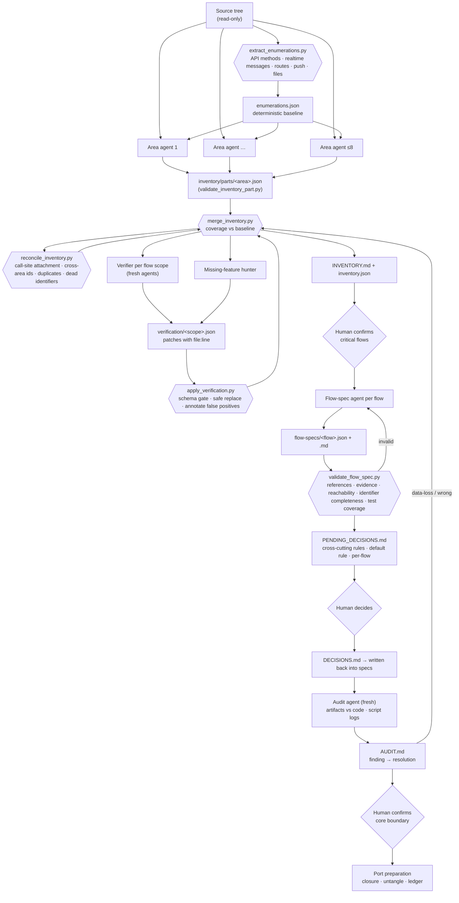

# Workflow: App Migration (Feature Inventory & Flow Specs)

**Status:** implemented · **Skills:** [`feature-inventory`](../../skills/feature-inventory/SKILL.md), [`flow-spec`](../../skills/flow-spec/SKILL.md), [`port-prep`](../../skills/port-prep/SKILL.md) · **Contracts:** [`feature-inventory-part.schema.json`](../../schemas/feature-inventory-part.schema.json), [`inventory-verification.schema.json`](../../schemas/inventory-verification.schema.json), [`flow-spec.schema.json`](../../schemas/flow-spec.schema.json) · **Evals:** [`evals/feature-inventory`](../../evals/feature-inventory/README.md), [`evals/flow-spec`](../../evals/flow-spec/README.md)

Prepares the migration of a large existing iOS app to a new app: a
complete, independently verified **feature inventory** of what the old app
does, **flow specs** (state machines with evidence and acceptance tests) for
its critical flows, a **decision log** that separates "what it does
today" from "what the new app should do", an **independent audit** of all
of it, and a **port preparation** that untangles the core layer. Nothing in
the old app is modified.

## Why

Rewriting an app from a legacy codebase fails in a predictable way: the
team ports what it remembers, and the rest surfaces as "regressions" months
later. Asking one agent to "list all features" gives a plausible list with
no way to know what it missed. Two properties fix this:

1. **Measured completeness.** The code itself enumerates the sources of
   truth (API methods, realtime messages, routes, push types, files). Agents
   claim features against that baseline, and a script reports what no
   feature claims. Coverage becomes a number, not an impression.
2. **Independent verification.** Agents that did not author the inventory
   verify it against the code, flow by flow, and correct it with evidence.
   In the run this was derived from (a ~150k-line, ~950-file SwiftUI/UIKit
   app), coverage was already complete after reconciliation, yet
   verification corrected about 70% of core and high features. Coverage was
   good; detail was weak. Verification is not optional.

## Architecture



This is the first workflow in the toolkit that uses subagents. The
justification is capacity and independence, not convenience: the source
does not fit one context, and verification by the author of a part is not
verification.

## Stages

| # | Stage | Who | Output |
|---|---|---|---|
| 1 | Extract the baseline from code, per-project config | deterministic | `inventory/enumerations.json` |
| 2 | Inventory each area (≤8, split by directory); every file claimed or unassigned | area agents, parallel | `inventory/parts/<area>.json` |
| 3 | Merge; coverage against the baseline; unknown ids, dangling `depends_on`, duplicates, core/high without flow | deterministic | `inventory/inventory.json`, `coverage.json` |
| 4 | Reconcile: attach unreferenced identifiers by call site, map cross-area ids, merge duplicates, assign strays, record dead identifiers | deterministic + orchestrator for ambiguities | `inventory/reconciliation.json`, updated parts |
| 5 | Verify by end-to-end flow scope with fresh agents, plus a missing-feature hunter; apply patches safely; annotate false positives; render | verifier agents + deterministic | `verification/<scope>.json`, `applied.json`, `INVENTORY.md` |
| 6 | Flow specs for the critical flows: state machine, invariants, interruptions, failures, cross-flow, as-is bugs, open decisions, acceptance tests | flow agents + validator | `flow-specs/<flow>.json`, `.md` |
| 7 | Decisions: cross-cutting rules decided once, a default rule, per-flow questions generated from the specs and deferred; written back into the specs | orchestrator + **human** + deterministic | `PENDING_DECISIONS.md`, `DECISIONS.md` |
| 8 | Independent audit of the artifacts against the code and the scripts' logs; every finding gets a resolution | audit agent + orchestrator | `AUDIT.md` |
| 9 | Port preparation: core type-dependency closure, coordinators and models tangled into UI, decoding changes in screen files, porting ledger | orchestrator + **human** (core boundary) | `port/core-closure.md`, `port/untangle.md`, `port/LEDGER.md` |

Everything lives under `.migration/` in the target repository, kept out of
git via `.git/info/exclude`.

## How the parts connect

| Artifact | Produced by | Consumed by |
|---|---|---|
| `enumerations.config.json` | the skill, per project | `extract_enumerations.py`, `reconcile_inventory.py` (call-site patterns) |
| `inventory/enumerations.json` | `extract_enumerations.py` | every validator, merge, reconcile, area and verifier agents |
| `inventory/parts/<area>.json` | area agents; edited by reconcile and apply | `validate_inventory_part.py`, `merge_inventory.py` |
| `inventory/inventory.json`, `coverage.json` | `merge_inventory.py` | reconcile, verifiers, render, `validate_flow_spec.py` |
| `inventory/reconciliation.json` | `reconcile_inventory.py` | the orchestrator (ambiguities), `render_inventory.py` (dead identifiers) |
| `reconcile.overrides.json` | the orchestrator after reading reports | `reconcile_inventory.py` |
| `verification/scopes.json`, `<scope>.json` | the orchestrator; verifier agents | `apply_verification.py` |
| `verification/orchestrator.json` | the orchestrator: settled disagreements, corrected replaces, `spec_note`s | `apply_verification.py` |
| `verification/applied.json` | `apply_verification.py` | the orchestrator; re-runs (fingerprints make apply idempotent) |
| `inventory/INVENTORY.md` | `render_inventory.py` | humans |
| `flow-specs/<flow>.json` | flow agents; decisions written back | `validate_flow_spec.py`, `render_flow_spec.py`, the porting step |
| `PENDING_DECISIONS.md` | the orchestrator (rules, default rule); `render_pending.py` (per-flow questions) | the human |
| `DECISIONS.md` | the human, recorded by the orchestrator | the specs (`cross_cutting_decisions`, `open_decisions[].decision`, `decision_ref`) |
| `AUDIT.md` | the audit agent; resolutions by the orchestrator | the human; toolkit lessons |
| `port/*.md` | the `port-prep` skill | the porting work |

Changing a schema means updating its validator, the skill that writes it,
the agent prompt template, and the example together.

## Deterministic vs agentic responsibilities

| Responsibility | Approach |
|---|---|
| Enumerate API methods, message types, routes, push types, files | **Deterministic** (brace-matched parsing, per-method scanning; config names the enums) |
| Decide the area split and call-site patterns | **Agentic**, recorded in config |
| Describe features: actions, flows, states, identifiers, files | **Agentic** (area agents) |
| Exact identifiers, one per item, that exist in the code | **Deterministic** (schema patterns + enumeration check) |
| Coverage against the baseline, file coverage, dangling references | **Deterministic** (`merge_inventory.py`) |
| Attach unreferenced identifiers to features | **Deterministic** by call site when the owner is unique; **agentic** for ambiguous files |
| Map guessed cross-area ids | Deterministic (strip notes, close match) with agentic overrides |
| Verify features against code | **Agentic** (fresh agents, scoped by flow) |
| Patch safety: replace swaps exactly one item matched by exact text or unique prefix, otherwise nothing changes and it is listed for review; never append, never collapse; every field patchable | **Deterministic** (`apply_verification.py`) |
| `file:line` evidence exists and is inside the file (core/high flow steps, patches, specs) | **Deterministic** (`evidence.py`) |
| Mentions of informational baseline keys (paths, SDKs, notifications, plist keys) | **Deterministic** (`merge_inventory.py` text coverage) |
| Resolve verifier disagreements | **Agentic** by direct code read, recorded as a patch |
| Flow state machines, invariants, interruptions, tests | **Agentic** (flow agents) |
| References, evidence, reachability, identifier completeness, test coverage | **Deterministic** (`validate_flow_spec.py`) |
| Readable renderings, the per-flow pending questions | **Deterministic** (`render_inventory.py`, `render_flow_spec.py`, `render_pending.py`) |
| Auditing what agents and scripts produced | **Agentic** (a fresh audit agent) |
| Core boundary, untangling plan | **Agentic**, boundary confirmed by the **human** |
| Target behavior | **Human** (decisions), never an agent |

## Context engineering

- The orchestrator never reads the whole tree. It reads reports:
  extraction counts, `coverage.json`, `reconciliation.json`,
  `applied.json`, validator output, and agents' short summaries.
- An area agent gets its directories, the baseline and the contract. A
  verifier gets a flow scope, the inventory slice for those features, the
  baseline and the contract. A flow agent gets its related features and the
  contract. None of them gets another agent's output to copy from.
- Patches, not rewrites: verifiers return deltas with evidence, so the
  orchestrator can apply, inspect and revert them individually.

## Human in the loop

| Decision | Who |
|---|---|
| Source root, area split, call-site patterns | Agent proposes from the code; **human confirms** before any agent is spawned |
| Ambiguous attachments, verifier disagreements | Agent, by direct code read, recorded |
| Which flows are critical | **Human** confirms the proposed list |
| Cross-cutting rules, default rule | **Human** |
| Per-flow questions | **Human**, deferred to porting time by default |
| "Align with the old app" | Decided only with `file:line` evidence that the old source was read |
| Audit findings | Agent proposes a resolution; data-loss and wrong findings are fixed before porting |
| Core layer boundary for porting | **Human** confirms |
| Any change to the old app | Never part of this workflow |

## Usage

```
/feature-inventory App/
```

Produces `.migration/inventory/INVENTORY.md` and the JSON artifacts. Expect
the skill to spawn up to eight area agents, then one verifier per flow scope
and a missing-feature hunter. Review the coverage summary and the
corrections it reports.

```
/flow-spec critical
```

Proposes the critical flows from the inventory, waits for confirmation,
writes and validates one spec per flow, then presents
`.migration/PENDING_DECISIONS.md` for decisions, writes them back and runs
the independent audit.

```
/port-prep App/Networking App/Realtime App/Models
```

Confirms the core boundary with you, then writes the closure, the untangle
list and the porting ledger under `.migration/port/`.

Scripts can be run by hand at any point:

```sh
python3 scripts/extract_enumerations.py .migration/enumerations.config.json --out .migration/inventory/enumerations.json
python3 scripts/validate_inventory_part.py .migration/inventory/parts/<area>.json
python3 scripts/merge_inventory.py --migration-dir .migration
python3 scripts/reconcile_inventory.py --migration-dir .migration --overrides .migration/reconcile.overrides.json
python3 scripts/apply_verification.py --migration-dir .migration [--dry-run]
python3 scripts/render_inventory.py --migration-dir .migration --title "<App> feature inventory"
python3 scripts/validate_flow_spec.py .migration/flow-specs/*.json --migration-dir .migration [--require-decisions]
python3 scripts/render_flow_spec.py .migration/flow-specs/*.json
python3 scripts/render_pending.py .migration/PENDING_DECISIONS.md .migration/flow-specs/*.json
python3 scripts/merge_inventory.py --migration-dir .migration --coverage-only
```

## Example

[`examples/migrations/pocket-threads`](../../examples/migrations/pocket-threads)
is a fully synthetic 17-file messaging app with every artifact of the
pipeline in its final state: the extractor config, baseline, two parts (as
authored, then reconciled and patched), a verification file, a
missing-feature file, a flow spec with decided and deferred decisions, and
the decision logs. `inventory/parts.as-authored/` holds the parts as the
"area agents" wrote them, with the mistakes the real run produced: a guessed
cross-area `depends_on`, identifiers a feature uses but did not list, a
stray shared file, a wrong known issue, and a feature nobody claimed.
It also has a non-API helper, a request built over several lines, a decoded
message nothing consumes, a source file path with a note attached, and an
orchestrator patch with a `spec_note`.

Two scripts keep the deterministic part honest:

```sh
evals/feature-inventory/replay.sh               # replay must reproduce the example exactly, twice
python3 evals/feature-inventory/negative_cases.py   # each real-run defect stays fixed
```

## Design decisions

- **Deterministic baseline before any agent.** Completeness is measured,
  not asserted. A feature list without a baseline cannot say what it missed.
- **Subagents, justified.** First use in the toolkit: the tree does not fit
  one context, parallel authors cut wall-clock time, and verification only
  counts when the verifier did not write the text. The orchestrator stays
  in the main conversation with the human.
- **Reconciliation is a step, not a hope.** Parallel authors cannot see
  each other; guessed ids, duplicate features and unclaimed identifiers are
  expected and handled by a script with a log.
- **Patches with a schema gate.** Verifiers write deltas; the schema makes
  every field patchable so nothing is smuggled as prefixed text; `replace`
  requires the old item so a flow can never collapse to one step.
- **As-is only.** Agents describe; humans decide. Target behavior lives in
  `open_decisions`, cross-cutting rules are decided once, and "replicate
  current behavior" is the explicit default for everything else.
- **Rendered Markdown is derived.** `INVENTORY.md` and the flow `.md` files
  are generated from JSON, so humans read one thing and scripts another
  without drift.
- **Exactly one item or nothing.** A patch that cannot be matched to exactly
  one item changes nothing and waits for review. Silently appending or
  fuzzy-matching left wrong claims next to their corrections in a real run.
- **Evidence that resolves.** A `file:line` reference is checked against
  the file, not just the pattern; plausible line numbers were often off.
- **An audit before porting.** Verifiers check the inventory; nobody checked
  the scripts until an independent audit found data they had silently
  corrupted. The audit is now a stage with a standard finding → resolution
  table.
- **Port preparation, not porting.** The workflow ends by untangling the
  core layer and opening a ledger. Porting features is a separate workflow,
  to be built from the first real port.

## Lessons from real use

From one full run on a large production app. Private details stay out of
this repository.

| Observed in a real run | Change |
|---|---|
| A lazy regex that scanned across function boundaries silently dropped about 12% of API methods from the baseline | Methods are found by brace-matched type bodies and each method's own text is scanned; counts are checked against a manual count before continuing |
| Extracting only `public` methods missed the internal ones the app actually calls | Every non-private method is extracted, including those in extensions; `include_private` is opt-in |
| Matching sub-route names by a bare `.name` attached them to hundreds of unrelated features | Call-site patterns are per project and match the navigation call form; the skill forbids bare-name patterns |
| Attaching an identifier to every feature that shares a call-site file over-attributed | Attachment only when the file has one owner; multi-owner files are reported as ambiguous for a code read |
| Verifiers' `replace` patches without the old value collapsed whole flows to one step | `replace` requires `old` and a list is never collapsed (tightened further after the audit, below) |
| Verifiers encoded unsupported fields as prefixed strings inside `flow` | The patch schema covers every feature field; prefixed strings are rejected by the gate |
| Agents wrote multi-value strings (`"a, b; c"`) in identifier fields | Identifier fields are validated per item against a pattern and the baseline, in parts and in patches |
| Parallel authors invented cross-area ids and duplicated features | A reconciliation step with overrides, a log, and merge of duplicates |
| Independent verification corrected ~70% of core/high features although coverage was complete | Verification is a mandatory stage, scoped by flow, by fresh agents; weakly authored scopes get a second verifier |
| The missing-feature hunter found almost nothing | Kept as a cheap confirmation that the baseline-coverage method works; it reports what it swept so "nothing" is credible |
| Two verifiers disagreed on the same feature | The orchestrator resolves it by a direct code read and records the result as its own patch |
| Agents drifted into target behavior ("should") inside flows and specs | Prompts require as-is only; target behavior must go to `open_decisions`; the eval grades this |
| 88 open questions across 8 flows mostly repeated the same themes | Decisions are grouped into cross-cutting rules decided once, plus a default rule; the rest is deferred to porting |

### Found by the independent audit of a full run

The audit compared the artifacts with the code and with the scripts' logs.
Each finding was resolved in the project and then here:

| Finding | Resolution |
|---|---|
| A replace matched its item by similarity, or appended when nothing matched; wrong claims stayed next to their corrections. An `old ==> new` form changed every item containing `old` | `old` is required and must match exactly one item, by exact text or unique prefix; otherwise nothing changes and the patch is listed for review |
| Known-issue verdicts matched a 40-character prefix and annotated the wrong issue | Exact text or unique prefix; unmatched verdicts are listed (`annotate_unmatched`) |
| A bare `.name` route pattern attached routes through SwiftUI tokens (`.main`, `.center`, `.cancel`) | Route patterns must be route-shaped; bare ones are refused |
| Identifiers that appear in the files of many features were attached to all of them | More than two candidate features: reported as ambiguous, not attached |
| Merging duplicates dropped scalar fields and left the dropped id in scopes and specs | Higher criticality kept, summaries combined, missing fields copied; ids rewritten in scopes and specs, resolved in patches |
| Normalizing `source_files` deleted `"(note)"` remarks, and `REPLACES [...]` patches were discarded | Notes move to `source_file_notes`; source-file patches must be real paths and are rejected otherwise |
| Non-API helpers were counted as API methods; multi-line request builders lost their path | `exclude` for helpers; the path is searched in the whole method body |
| "Parsed but unconsumed" counted only `case .x`, so messages consumed via `==` or a filter list looked dead | Switch arms (grouped too), `==`/`!=` comparisons and array-literal membership all count |
| The baseline missed SDK callbacks, dependencies, notifications, plist keys and other enumerable sources | New extractor kinds; informational keys get text coverage in the inventory and specs |
| Re-merging rebuilt the inventory from parts and lost patches applied to it | `--coverage-only`, and every correction is a patch on the parts |
| Evidence lines pointed past the end of files; specs had unreachable states and uncovered failures | Evidence is resolved against the source; unreachable states and uncovered items are errors; `entry_states` for several entry points |
| Pending questions were rebuilt by hand and re-listed decided ones | `render_pending.py` generates them from the specs; decided questions never reappear |
| "Align with the legacy app" was marked decided without anyone reading the old source | Such decisions need `decision_evidence` with `file:line` |
| Core/high features without a spec had no recorded reason | `spec_note` via an orchestrator patch; `--coverage-only` fails without it |
| Extensions in screen files changed how core models decoded | A port-preparation step searches for them before porting |
