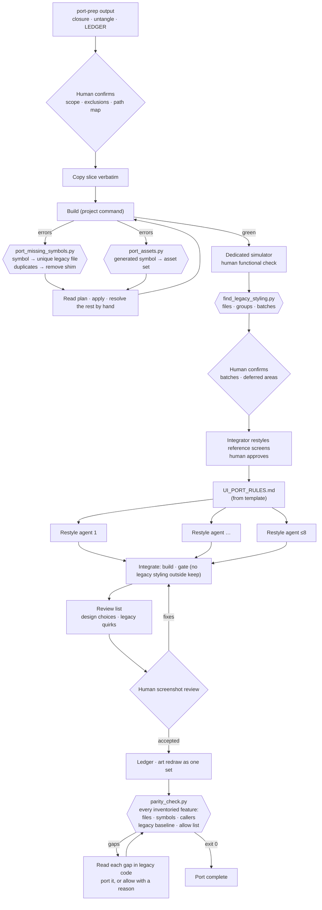

# Workflow: App Port (Code & UI)

**Status:** implemented · **Skills:** [`port-code`](../../skills/port-code/SKILL.md), [`ui-port`](../../skills/ui-port/SKILL.md) · **Scripts:** [`port_missing_symbols.py`](../../scripts/port_missing_symbols.py), [`port_assets.py`](../../scripts/port_assets.py), [`find_legacy_styling.py`](../../scripts/find_legacy_styling.py), [`parity_check.py`](../../scripts/parity_check.py) · **Eval:** [`evals/app-port`](../../evals/app-port/README.md)

Moves a legacy iOS app into a new app after [App Migration](app-migration.md)
has inventoried it, specified its critical flows and prepared the core layer.
Two stages: **port the code** verbatim, driven by build errors, until the new
app builds and behaves like the old one; then **port the UI**, rebuilding the
view layer on the new design system with parallel restyle agents and a
human screenshot review.

## Why

A rewrite loses behavior in the places nobody remembers. Copying the legacy
code first and letting the compiler list what is missing makes the
dependency closure exact without anyone reasoning about it, and the new app
behaves like the old one from the first green build. The view layer is then
the only thing that changes, which is work that parallelizes well, provided
every agent follows the same written rules and nothing but the styling
moves.

Both halves need deterministic help. Build errors name symbols, not files,
and asset errors name generated symbols (`chatSend`), not set names
(`chat-send`); a script turns both into exact copy plans. A restyle has no
natural "done"; a script that finds the legacy styling forms is the gate.

## Architecture



## Stages

| # | Stage | Who | Output |
|---|---|---|---|
| 1 | Scope, exclusions, path map, asset folder | orchestrator proposes, **human confirms** | `port/path-map.json`, ledger `gap` rows |
| 2 | Copy the slice verbatim; build loop with symbol and asset plans | orchestrator + deterministic | ported files, `Legacy` asset folder |
| 3 | Shims and placeholders so the app runs early; removed when originals arrive | orchestrator | ledger `shim` / `stub` rows opened and closed |
| 4 | Green build; functional check on a dedicated simulator | deterministic + **human** | verified slice |
| 5 | Measure legacy styling; batches by surface family | deterministic + **human** | `port/styling.config.json`, batch list |
| 6 | Reference screens restyled and approved | integrator + **human** | approved examples, shared components |
| 7 | Parallel restyle agents under one rules file | restyle agents | restyled views, agent reports |
| 8 | Integrate: build, legacy-styling gate, review list | integrator + deterministic | green build, empty gate, review list |
| 9 | Screenshot review and fixes; product art redrawn as a set | **human** + integrator | accepted screens |
| 10 | Parity gate: every inventoried feature's files and symbols present and still called; deliberate gaps allowed with reasons | deterministic + orchestrator, **human** reads the allow list | parity report, exit 0 |

## Deterministic vs agentic responsibilities

| Responsibility | Approach |
|---|---|
| Which legacy file declares a missing symbol; which declares a missing member inside `extension T` | **Deterministic** (`port_missing_symbols.py`, unique match only) |
| Several or no declaring files; an edited copy that dropped the symbol | **Agentic**, by reading the candidates |
| Temporary copies made obsolete by an arriving original | **Deterministic** detection (duplicates), **agentic** removal + ledger |
| Generated asset symbol → set name; never AccentColor or app icons | **Deterministic** (`port_assets.py`) |
| Where legacy styling remains; balanced batches | **Deterministic** (`find_legacy_styling.py`) |
| Batch families, reference screens, port rules | **Agentic**, confirmed by the **human** |
| Restyling views | **Agentic** (parallel agents, styling only) |
| Design choices made for the user; legacy quirks | Agents list them; the **human** decides |
| Accepting the look | **Human**, from the simulator |
| Whether every inventoried feature survived (files, API methods, realtime types, routes, keys; declared but no longer called) | **Deterministic** (`parity_check.py`, legacy app as baseline) |
| Whether a gap is deliberate | **Agentic** reading of the legacy code, recorded in `allow` with a reason the **human** sees |

## Usage

```
/port-code core
/port-code Profile Chat Settings
/port-code the rest
```

Proposes scope, exclusions and the path map, waits for confirmation, copies,
then runs the build loop until green and hands you a functional check.

```
/ui-port all
```

Measures the legacy styling, proposes batches, restyles reference screens
for your approval, runs the restyle agents, gates, and gives you a review
list for the simulator.

Scripts by hand:

```sh
python3 scripts/port_missing_symbols.py --legacy <legacy> --target <new src> \
    --errors build-errors.txt --path-map .migration/port/path-map.json [--apply]
python3 scripts/port_assets.py --legacy-catalog <legacy>/Assets.xcassets --target-src <new src> \
    --into <new src>/Resources/Assets.xcassets/Legacy --errors build-errors.txt --scan [--apply]
python3 scripts/find_legacy_styling.py .migration/port/styling.config.json [--batches 6]
python3 scripts/parity_check.py .migration/parity/parity.config.json --md .migration/parity/report.md
evals/app-port/run.sh
```

## Design decisions

- **Verbatim first, restyle second.** Behavior moves by copying; only the
  view layer is rebuilt. A combined "port and redesign" mixes two sources of
  regressions and makes neither reviewable.
- **The compiler computes the closure.** Static closure analysis
  (`port-prep`) finds tangles; the build loop finds exactly what the slice
  needs, round by round.
- **Exactly one candidate or nothing.** As in App Migration, a symbol with
  several declaring files is not guessed; an agent reads them.
- **Members are matched by owner.** A missing `T.m` is satisfied only by a
  file that declares `m` inside `extension T` or `T` itself; in a real run, a
  name-only search copied an unrelated API client because an image had the
  same name as one of its methods.
- **No custom derived data, one simulator per session.** Both caused real
  failures (a full disk; another session's app launched on a shared
  simulator).
- **Agents do not build.** Parallel builds of one project collide; the
  integrator builds once, after all agents return.
- **Reference screens before agents.** Agents follow approved code more
  reliably than descriptions; the same pieces are reused everywhere.
- **The human review is a stage.** Every defect after integration in the
  real run came from the user's screenshots, not from the build.
- **Parity is checked against the inventory, not remembered.** A green build
  says only that what was copied compiles. The gate checks every feature's
  files and symbols, and flags symbols that are still declared but no longer
  called: a restyle that drops a call still builds. The legacy app is the
  baseline, so code that was already dead there is reported as inherited
  rather than drowning the real gaps. Presence is not behavior; flow-spec
  acceptance tests and runtime checks cover the rest.
- **Product art as one set.** Badges and frames redrawn by one owner after
  the restyle stay consistent; split across agents they drift.

## Lessons from real use

From one full port of a large production app into a new app with a new
design system. Private details stay out of this repository.

| Observed in a real run | Change |
|---|---|
| A name-only search for a missing member copied an unrelated file whose method shared the name of an image | Members are matched inside `extension T` / `T`; `ImageResource` / `ColorResource` members go to the asset plan, never the code plan |
| The legacy AccentColor was copied with the other assets and recolored system controls | `port_assets.py` never copies AccentColor or app icons |
| Digit-leading asset names and `…Image` / `…Color` suffixes did not match their generated symbols | The generated-symbol rule is implemented and covered by the eval |
| Extracted route arguments, a shim and an extracted initializer turned into redeclaration errors when their originals arrived | Duplicates are reported with every declaring file; the skill removes the temporary copy and closes the ledger row |
| An agent commented out a call to make a file compile, silently dropping behavior | Never comment out or early-return to compile; port the dependency or shim it, and record it |
| A custom derived-data path filled the disk | Builds use the project's documented command only |
| Two sessions shared one simulator and the wrong app launched | A simulator dedicated to the session |
| Six parallel restyle agents changed ~300 files with one integration typo | Kept: one rules file, folder ownership, no builds by agents, a structured report |
| Text styled for a dark surface stayed white when the same view was shown in a light sheet | Port rules require checking where a view is presented before coloring text |
| Shadows applied to views with content duplicated text; strokes before shadows drew double outlines | Port rules: shadow on the background shape only, stroke after the shadow |
| A display-size numeral overflowed a four-column stat row with abbreviated values | Port rules: title/headline sizes in dense rows; the design-system specimen should include such a row |
| Agents noticed legacy bugs (an inverted icon, a value in the wrong row) | Listed in the review list and fixed only after the user decided |
| Tier and level art needed a consistent redraw | Kept during restyle; redrawn afterwards as one set by one owner |
| "Is every feature still there?" had no mechanical answer after ~400 inventoried features were ported and restyled | `parity_check.py` as the last gate; on the real port it ran in seconds, every remaining gap was either legacy dead code (inherited) or deferred work |
| Inventory entries sometimes hold notes ("Feature/X (other area)") instead of paths | Only path-like entries are checked; notes are listed as unchecked |
| A green parity gate still let a wire-format defect through (a renamed response key broke one list at runtime) | Stated in the skill: parity checks presence; runtime defects need acceptance tests and a run on the simulator |
