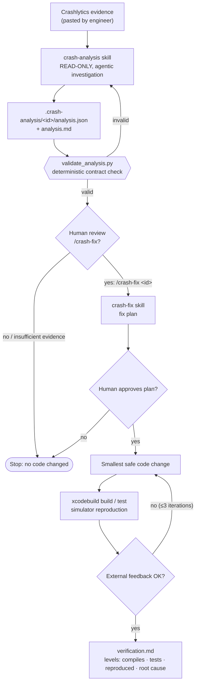
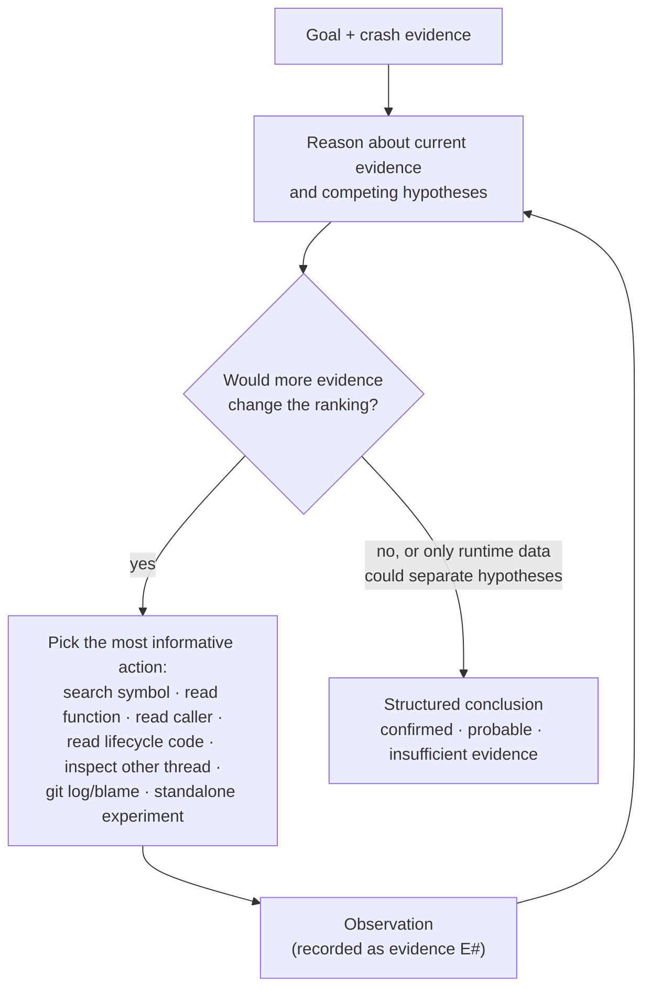

# Workflow: Crash Investigation & Fix

**Status:** implemented · **Skills:** [`crash-analysis`](../../skills/crash-analysis/SKILL.md), [`crash-fix`](../../skills/crash-fix/SKILL.md) · **Contract:** [`crash-analysis.schema.json`](../../schemas/crash-analysis.schema.json) · **Eval:** [`evals/crash-analysis`](../../evals/crash-analysis/README.md)

Investigates a Firebase Crashlytics issue inside an iOS repository, produces
ranked, evidence-backed root-cause hypotheses, and fixes the crash only after
explicit human approval. The fix is then verified with build, test and
simulator feedback.

## Why

Coding agents are good at reading unfamiliar code and correlating signals. In
crash work they also tend to:

1. **Overclaim:** jump from the top stack frame to a confident root cause, or
   call a crash "fixed" because the code compiles.
2. **Over-act:** edit code before the problem is understood, or widen a fix into
   a refactor.

This workflow counters both with explicit evidence discipline, a structured
contract between investigation and fix, human approval gates, and verification
that reports what was actually verified.

## Architecture



Two skills with a stable JSON contract between them, a deterministic gate, and
two human decisions. There is no separate orchestrator: the workflow is the
skills plus the contract plus the human gates.

## The investigation loop

`crash-analysis` does not follow a fixed script. It runs an
observe → reason → act loop and decides which evidence to fetch next:



## Deterministic vs agentic responsibilities

| Responsibility | Approach |
|---|---|
| Read crash metadata from the pasted report | Agentic (input format is inconsistent; a parser would be brittle) |
| Search and read the repository, git history | Tool execution |
| Decide which code or evidence to inspect next | **Agentic** |
| Correlate breadcrumbs/custom keys with code paths | **Agentic** |
| Generate and rank root-cause hypotheses | **Agentic** |
| Prove a suspected mechanism with a standalone experiment | Agentic design, **deterministic** result |
| Decide whether evidence is sufficient | **Agentic**, constrained by the contract |
| Validate analysis structure and cross-field consistency | **Deterministic** (`validate_analysis.py`) |
| Start a fix | **Human** (`/crash-fix` cannot be triggered by the model) |
| Approve the fix plan, risky or broad changes | **Human** |
| Build, test, simulator runs | **Deterministic** (`xcodebuild`, `simctl`) |
| Interpret compiler/test/runtime results and revise | Deterministic feedback + agentic interpretation |

## Context engineering

The investigator receives **high-signal evidence**, not the repository: crash
type and message, the crashed thread and other relevant threads, breadcrumbs,
custom keys, and app/OS/device distribution and counts.

It then loads code **just in time**, following the evidence outward from the
crash site:

```
crash points to PlayerSession.applyQuality(_:)
  → search the symbol, read the function       (engine is an IUO)
  → where is engine set to nil?                 (background handler)
  → who calls applyQuality?                     (sheet dismissal)
  → do breadcrumbs order these events?          (yes: background before dismiss)
```

Crash-category reference material is a separate file that is read only when a
category becomes relevant (progressive disclosure). The analysis JSON is a
context boundary: `crash-fix` reads the conclusion and the cited code instead
of reconstructing the investigation.

## Degree of autonomy

| Stage | Autonomy |
|---|---|
| Crash analysis | Automatic, read-only. Writes only its own report under `.crash-analysis/` |
| Starting a fix | Explicit user command only (`disable-model-invocation`) |
| Applying the fix | After the user approves a written fix plan |
| Widening scope / risky changes | Stops and asks again |
| Commit / push | Only when asked |

## Usage

### 1. Analysis

What to provide from Crashlytics, in order of value:

| Input | Where in Crashlytics | Why |
|---|---|---|
| Full stack trace (all threads) | Stack trace tab | Crashed thread plus other threads touching the same objects/queues |
| `crash_info_entry_*` keys | Keys tab | Swift `Fatal error:` messages appear only here and are often the most precise evidence |
| Crash session export (JSON) | Logs & Breadcrumbs / session download | Event order before the crash |
| Version/build, OS, device, events, users | Issue header / Data tab | Impact and regression window |
| Other variants' crashed thread | Variants | Can separate competing hypotheses |

Screenshots are optional. Leave out user IDs; the skill redacts them anyway.

```
/crash-analysis <paste report, or path to a file containing it>
```

Output, in the iOS repo (kept out of git via `.git/info/exclude`):

```
.crash-analysis/<issue-id>/analysis.json   # contract
.crash-analysis/<issue-id>/analysis.md     # readable report
```

The skill never edits source code. Ask follow-up questions before deciding.

### 2. Fix

```
/crash-fix <issue-id>
```

It validates the analysis and refuses to proceed if the analysis did not
justify a change (unless you explicitly override). It then presents a fix
plan, waits for approval, implements the smallest change, and runs
build/test/simulator checks. `verification.md` reports separately whether the
code compiles, whether tests pass, whether the crash was reproduced before the
fix and not after, and whether the root cause is confirmed or still probable.
A change that addresses only the immediate cause is labeled as a mitigation.

## Example

[`examples/crashes/player-quality-nil-engine`](../../examples/crashes/player-quality-nil-engine)
is a fully synthetic case:
- input: [`crashlytics-report.md`](../../examples/crashes/player-quality-nil-engine/crashlytics-report.md)
- code: [`source/`](../../examples/crashes/player-quality-nil-engine/source)
- expected output: [`analysis.json`](../../examples/crashes/player-quality-nil-engine/analysis.json) / [`analysis.md`](../../examples/crashes/player-quality-nil-engine/analysis.md)

The top frame is `libswiftCore _assertionFailure`; the useful frame is the app
frame below it. The implicit unwrap is the symptom; breadcrumbs and a custom
key show the engine was released on background before the sheet was dismissed.
The verdict is **probable**, not confirmed, because it has not been reproduced.

## Design decisions

- **Skills, not subagents.** Analysis runs in the main conversation so the
  engineer can question it before approving a fix, and so the fix step can
  reuse what was read. If real investigations flood the context, the skill can
  switch to a forked context with one frontmatter line.
- **Read-only is enforced in layers.** Pre-approved tools are read, search and
  git only; the skill forbids edits; any other write still asks for permission.
  The human gate is the real control.
- **JSON contract + Markdown report.** JSON keeps the hand-off and evals stable;
  Markdown is for humans. The validator checks cross-field rules a schema
  cannot, e.g. hypotheses may cite only recorded evidence, and
  `insufficient_evidence` cannot justify a code change.
- **No crash parser.** Pasted Crashlytics text varies in shape; the model reads
  it reliably. A parser would be brittle code without a demonstrated need.
- **Verification levels instead of "fixed".** Compiling, passing tests,
  reproduction before/after and root-cause confirmation are different claims.

## Lessons from real use

Each real investigation is graded against the
[eval rubric](../../evals/crash-analysis/README.md), and generalizable failures
become changes to the skills. Private details stay out of this repository.

| Observed in a real run | Change |
|---|---|
| Swift fatal error message only available in Crashlytics keys; crashed thread was not main; session JSON exports | Crashlytics intake guidance; "what to provide" table |
| Hashable violation had to be squeezed into an unrelated category | `hashable_invariant` category with its exact trap condition |
| Right root-cause family and fix, but the causal chain could not produce the trap, and the proposed test would pass on unfixed code. A standalone `swiftc` experiment found the missing condition | Mechanism must be checked against the exact failure condition; regression tests count only if they fail on unfixed code |
| Confidence raised from an untested fix in another codebase whose precondition could not occur here | Immediate and upstream causes rated separately; analogies are hypotheses, not evidence; immediate-cause-only changes labeled as mitigations |
