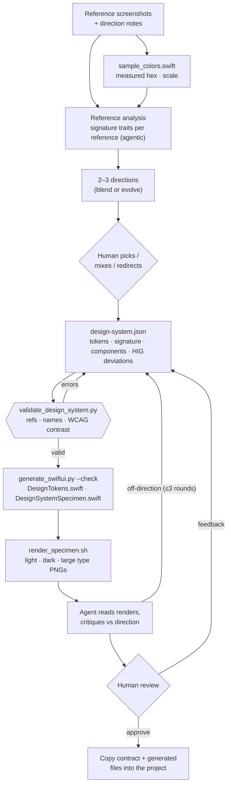

# Workflow: Design System

**Status:** implemented (V1) · **Skill:** [`design-system`](../../skills/design-system/SKILL.md) · **Contract:** [`design-system.schema.json`](../../schemas/design-system.schema.json) · **Eval:** [`evals/design-system`](../../evals/design-system/README.md)

Creates an original, reusable design system for an iOS app from reference
screenshots (from other apps, or from the user's own earlier app) plus the
user's direction. The output is a validated contract, generated SwiftUI tokens,
and a rendered specimen.

## Why

When an agent builds a SwiftUI app without design input, it converges on
Apple's defaults: system font, standard sizes, ~10–12pt corner radii, blue
accent, grouped lists. The result is correct and forgettable. Asking for
"a unique design" does not fix this, because nothing concrete anchors the
choices.

This workflow anchors them. Concrete references supply real traits, the human
decides the direction, and a contract makes the result reusable. The contract
is consumed by generated code now, and by UI implementation later.

## Architecture



The render step closes the loop. The agent does not only write tokens; it
**looks at what the code actually draws** and revises. This is the visual
counterpart of build/test feedback in the crash workflow.

## Deterministic vs agentic responsibilities

| Responsibility | Approach |
|---|---|
| Color values from screenshots | **Deterministic** (`sample_colors.swift`: k-means, exact mode color per cluster) |
| Pixel → point scale | **Deterministic** (known iPhone widths) |
| Recognizing signature traits, naming a style | **Agentic** |
| Spacing, radii, font sizes from screenshots | **Agentic estimate**, labeled in `estimates` |
| Proposing directions, mixing traits | **Agentic** |
| Choosing the direction, approving the result | **Human** |
| Contract structure, token references, Swift-safe names | **Deterministic** (`validate_design_system.py`) |
| Text contrast in light and dark | **Deterministic** (WCAG ratio: <3:1 error, <4.5:1 warning) |
| SwiftUI tokens, Dynamic Type styles, component modifiers, specimen | **Deterministic codegen** (`generate_swiftui.py`) |
| Generated code compiles for iOS | **Deterministic** (`--check` typechecks against the Simulator SDK) |
| What the specimen looks like | **Deterministic render** (`render_specimen.sh`) + agentic critique |

The agent never types hex values from impressions or hand-writes token code.
Measured inputs and generated outputs keep the agentic part focused on
judgment.

## The contract

[`design-system.schema.json`](../../schemas/design-system.schema.json)
holds more than tokens, because tokens alone still produce generic UI:

| Section | Purpose |
|---|---|
| `direction` | Mode (blend/evolve), human directives, mood, why this direction |
| `references` | Which traits were taken from which reference |
| `signature` | The few traits that make the system recognizable |
| `colors` | Semantic roles, light/dark values, origin (sampled/derived/chosen) |
| `typography` | Families with licenses; styles bound to Dynamic Type text styles |
| `spacing`, `radii`, `shadows`, `borders` | Token scales |
| `components` | Recipes expressed only in tokens |
| `guidelines` | Do / don't rules for implementation |
| `hig_deviations` | Deliberate departures from Apple defaults, with reasons |
| `estimates` | Every value estimated by eye rather than measured |

## Generated SwiftUI

```swift
Text("Continue")
    .dsComponent(DS.Components.primaryButton)

VStack(spacing: DS.Spacing.md) {
    Text(title).dsFont(.headline)          // scales with Dynamic Type
    Text(body).dsFont(.body)
        .foregroundStyle(DS.Colors.inkMuted)
}
.padding(DS.Spacing.md)
.background(DS.Colors.card, in: DS.Shapes.crisp)
```

Colors are dynamic (light/dark) without an asset catalog. Text styles scale
with `@ScaledMetric` relative to a system text style. `DesignSystemSpecimen`
has Light, Dark and Large-type previews in Xcode.

## Human in the loop

| Decision | Who |
|---|---|
| Mode and references | Human provides |
| Direction among 2–3 options | **Human** |
| Contrast warnings: change color or restrict usage | Agent proposes, human confirms |
| Final approval after seeing renders | **Human** |
| Where files go in the project, project-file changes | **Human** |

## Example

[`examples/design-systems/paper-lantern`](../../examples/design-systems/paper-lantern)
is a synthetic *blend* of three references: a warm editorial system with
serif display type, paper surfaces, a single vermilion accent and hairline
depth.

| Light | Dark |
|---|---|
|  |  |

The renders were checked round-trip: sampling them with `sample_colors.swift`
returns the contract's exact hex values in both modes.

## Design decisions

- **Contract first, code generated.** The contract is reviewable, diffable
  and reusable by later workflows (UI implementation, visual review).
  Generated code is never edited by hand, so the two cannot drift.
- **Render instead of describing.** The agent reads PNG renders of the
  specimen. A design cannot be judged from a JSON file, and neither can
  the agent judge one.
- **SwiftUI specimen, not HTML.** An HTML page cannot reproduce SF fonts,
  continuous corners or dynamic colors faithfully. The render runs the real
  generated code on the iOS Simulator.
- **No Xcode project for rendering.** `render_specimen.sh` compiles a tiny
  app with `swiftc` and installs it on a simulator. It has no dependencies
  and touches nothing in the user's project.
- **No subagent yet.** Analyzing up to ten screenshots in one context is
  manageable. Per-reference analysis in isolated subagents is the first
  candidate if context becomes a problem in real use.
- **Accessibility is not negotiable.** Contrast is checked mechanically,
  text styles scale with Dynamic Type, and component recipes warn below
  44pt.

## Lessons from real use

None yet: the first real run is the next step.
