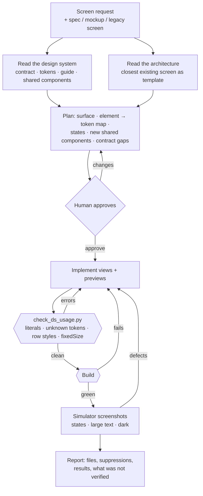

# Workflow: SwiftUI UI Implementation

**Status:** implemented · **Skill:** [`ui-implement`](../../skills/ui-implement/SKILL.md) · **Script:** [`check_ds_usage.py`](../../scripts/check_ds_usage.py) · **Eval:** [`evals/ui-implementation`](../../evals/ui-implementation/README.md)

Builds new screens and components on the project's design system (a
[Design System](design-system.md) contract and its generated tokens), inside
the project's existing architecture. Use it for new screens. To restyle
screens ported from a legacy app, use the `ui-port` stage of
[App Port](app-port.md).

## Why

A design system that exists only as tokens does not keep screens consistent.
In a real port, restyled screens used the tokens and still drifted from the
design system in ways a review had to catch one by one:
- display-size numbers in list rows;
- a row whose `fixedSize` text pushed it past the screen width;
- text colored for a dark surface, placed on a light sheet;
- literal font sizes in dense overlays.

Each defect looked reasonable on its own. Finding one meant searching every
sibling screen for the same pattern.

This workflow moves those checks to before the screenshot. The element map is
agreed first, every text style is checked against where the contract allows
it, and a deterministic gate finds literals and row defects in the code.

## Architecture



## Deterministic vs agentic responsibilities

| Responsibility | Approach |
|---|---|
| Token names, spacing scale, text style sizes and `uses` | **Deterministic** (the contract) |
| Literal colors, fonts, spacing and radii; unknown tokens | **Deterministic** (`check_ds_usage.py`) |
| A text style not meant for rows inside a row file; `fixedSize` in a row | **Deterministic** (`check_ds_usage.py`, from the contract's `uses`) |
| Choosing the template screen and following its patterns | **Agentic** |
| Mapping elements to tokens and components; the states to cover | **Agentic**, approved by the human |
| Whether a missing token belongs in the contract | Agent proposes, **human** decides |
| Whether the result looks right | Screenshots read by the agent; then [Visual Review](visual-review.md) and the human |

## Usage

```
/ios-agentic-toolkit:ui-implement the gift history screen, spec in docs/gifts.md, into Features/Gifts
```

The gate on its own:

```sh
python3 <toolkit>/scripts/check_ds_usage.py App/DesignSystem/design-system.json App/Features/Gifts \
    --exclude 'App/DesignSystem/Generated/*' --out ds-usage.json
```

Rules and severities are listed in the script's header. A suppression needs a
reason: `// ds-lint: allow literal-spacing hairline offset that matches the separator`.

## Design decisions

- **The project's architecture wins.** The skill copies the closest existing
  screen's patterns rather than bringing its own. A UI workflow that changes
  how view models or navigation work is a refactor, and it needs its own
  approval.
- **Plan before code.** The element map is where design decisions happen:
  which style a number gets, which action is primary. Reviewing them in a
  plan is cheaper than reviewing them in screenshots.
- **A line-based check, not a Swift parser.** The defects it targets are
  visible on one line (a literal, a style name, a modifier). A regex scan has
  no dependencies, runs in milliseconds and is easy to extend. Cases it
  cannot judge are handled by suppressions with reasons.
- **Row files by name.** "Is this text in a list row?" cannot be answered
  from one line. File names (`...Row`, `...Cell`, `...Item`) can answer it,
  and real projects already use these names. `--row-files` adapts the
  convention.
- **Symbol sizing is not text.** `.font(.system(size:))` on an `Image(...)`
  chain sizes an SF Symbol. In the real project, flagging it would have
  buried the 100 text literals under 400 icon sizes.
- **No subagent.** One screen fits in one context. Parallel agents already
  exist for bulk restyling (`ui-port`).

## Lessons from real use

| Observed in a real run | Change |
|---|---|
| A screenshot review of a ported app found display-size numbers in list rows and a row that overflowed the screen width; the same pattern sat in sibling screens | Contract `uses` for text styles; `row-text-style` and `fixed-size-in-row` rules; dense rows in the specimen |
| Running the first version of the check on the real project: most literal-font findings were SF Symbol sizes | Modifier chains on `Image(...)` are skipped |
