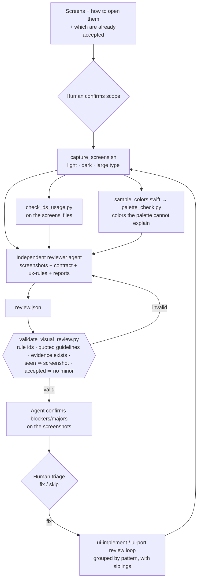

# Workflow: Visual Review

**Status:** implemented · **Skill:** [`visual-review`](../../skills/visual-review/SKILL.md) · **Rules:** [`ux-rules.md`](../../skills/visual-review/ux-rules.md) · **Contract:** [`visual-review.schema.json`](../../schemas/visual-review.schema.json) · **Scripts:** [`capture_screens.sh`](../../scripts/capture_screens.sh), [`palette_check.py`](../../scripts/palette_check.py), [`validate_visual_review.py`](../../scripts/validate_visual_review.py), [`check_ds_usage.py`](../../scripts/check_ds_usage.py) · **Eval:** [`evals/visual-review`](../../evals/visual-review/README.md)

Compares implemented screens with the design-system contract and a short set
of mobile UX rules, from simulator screenshots. It is read-only: findings go to
the human, and the fixes the human approves go back to
[UI Implementation](ui-implementation.md) or to the review loop of
[App Port](app-port.md).

## Why

In a real port, the screenshot review was where the remaining UI defects were
found, and the human did that review by hand. Most screens were fine. The
corrections came down to a few patterns:
- display-size numbers in list rows;
- a row overflowing the screen width;
- a header row sized like a title;
- names too small in cards that had room for them.

Each pattern was found on one screen and then searched for in its siblings.
A useful automated review finds these patterns. It does not produce a long
list of opinions about screens the human has already accepted.

## Architecture



## Deterministic vs agentic responsibilities

| Responsibility | Approach |
|---|---|
| Screenshots in light, dark and large type, the simulator restored afterwards | **Deterministic** (`capture_screens.sh`) |
| Literal styling, unknown tokens, row styles and `fixedSize` in code | **Deterministic** (`check_ds_usage.py`) |
| Colors on screen that no token, and no blend of two tokens, explains | **Deterministic** (`palette_check.py`, CIE76 ΔE) |
| Seeing overflow, hierarchy, contrast on the wrong surface, inconsistent components | **Agentic** (independent reviewer) |
| A finding cites an existing rule, a verbatim guideline, existing evidence | **Deterministic** (`validate_visual_review.py`) |
| What gets fixed | **Human** |

## Usage

```
/ios-agentic-toolkit:visual-review leaderboard and wallet screens; open with -screen leaderboard / -screen wallet; profile is already accepted
```

## Design decisions

- **Read-only.** A reviewer that also fixes things grades its own work and
  widens changes nobody approved. Fixes go through the implementation skills,
  after the human's triage.
- **An independent reviewer.** The agent that built a screen knows what it
  meant to draw, and it tends to see that. A fresh context gets only the
  screenshots, the contract and the rules. This is the same reason App
  Migration uses independent verifiers.
- **Few rules, cited by id.** Each finding names one rule from
  `ux-rules.md`, a contract guideline quoted verbatim, or a lint rule. The
  validator rejects anything else, which keeps taste out of the list.
- **Accepted screens are calibrated.** The human has already approved most
  screens, so for those the review reports only blockers and major issues.
  The validator enforces this.
- **Palette check with blends.** Antialiased text and translucent overlays
  produce colors that are not tokens but are mixes of two tokens. Without
  the blend test, every screenshot would report dozens of false positives.
  Unexplained colors are leads, because photos and avatars are content.
- **Variants by relaunch.** `capture_screens.sh` relaunches the app for each
  appearance, so trait changes start clean. It restores the simulator's
  settings, because the simulator is shared with the human's own testing.

## Lessons from real use

| Observed in a real run | Change |
|---|---|
| The human's screenshot review of a port found a few repeated patterns, each later searched for in sibling screens | Findings carry `siblings`; fixes are handed back grouped by pattern |
| The human had accepted most screens and wanted no changes to them beyond real problems | `accepted_before` limits those screens to blocker and major findings |
| A full-screen capture on a Dynamic Island device reported `#000000` as off-palette | `palette_check.py --ignore` |
