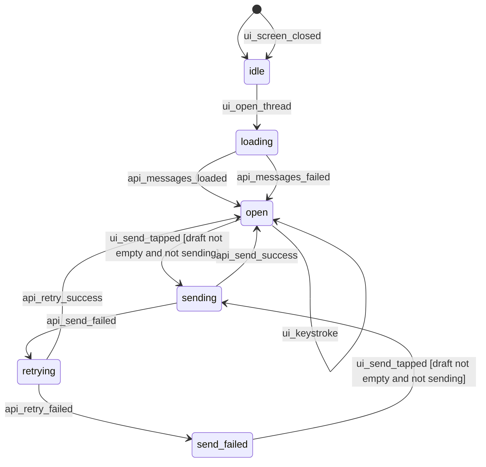

# Flow spec: Open a conversation, receive and send messages

`send-message` · actors: user, server, realtime socket

Describes current behavior as implemented (as-is). Target behavior is listed under Open decisions.
Generated from the JSON spec; do not edit.

## Related features

`send-message`, `thread-list`

## Preconditions

- User is signed in and the conversation list has loaded
- SocketClient.shared is connected (there is no reconnect handling in the client)

## State diagram

## States

| State | Actor | Description | UI | Resources |
|---|---|---|---|---|
| `idle` | user | Conversation list is shown; no conversation is open. | ThreadListView | socket connected, no thread joined |
| `loading` | user | ThreadView appeared; messages are being fetched. | empty list, composer enabled | fetchMessages in flight |
| `open` | user | Messages shown; realtime thread joined; read receipt sent. | message list, composer, optional typing label | thread joined via joinThread; onMessage closure owned by this screen |
| `sending` | user | First sendMessage attempt in flight. | send button disabled | sendMessage in flight |
| `retrying` | user | Silent second sendMessage attempt after a failure. | send button still disabled, no error yet | sendMessage in flight |
| `send_failed` | user | Both attempts failed; error label shown; conversation stays open. | 'Could not send' label under the composer | thread still joined |

## Events

| Event | Source | Identifier | Payload |
|---|---|---|---|
| `ui_open_thread` | user | `ThreadListViewModel.open` | thread id |
| `api_messages_loaded` | api_response | `fetchMessages` | messages |
| `api_messages_failed` | api_response | `fetchMessages` | error |
| `ws_message_received` | ws | `messageReceived` | message |
| `ws_typing_started` | ws | `typingStarted` |  |
| `ui_keystroke` | user | `TextField.onChange` | draft |
| `ui_send_tapped` | user | `Send button` | draft |
| `api_send_success` | api_response | `sendMessage` | message |
| `api_send_failed` | api_response | `sendMessage` | error |
| `api_retry_success` | api_response | `sendMessage` | message |
| `api_retry_failed` | api_response | `sendMessage` | error |
| `ui_screen_closed` | user | `ThreadView.onDisappear` |  |

## Transitions

| # | From | Event | Guard | Actions | To | Evidence |
|---|---|---|---|---|---|---|
| T1 | idle | ui_open_thread |  | ui:navigate(.thread); api:fetchMessages | loading | `Features/Threads/ThreadListViewModel.swift:15` |
| T2 | loading | api_messages_loaded |  | ui:show messages; ws_out:joinThread; ui:subscribe onMessage; api:markThreadRead | open | `Features/Thread/ThreadViewModel.swift:14` |
| T3 | loading | api_messages_failed |  | ui:show empty list (error swallowed); ws_out:joinThread; ui:subscribe onMessage; api:markThreadRead | open | `Features/Thread/ThreadViewModel.swift:15` |
| T4 | open | ws_message_received | payload decodes to a Message | ui:append message | open | `Features/Thread/ThreadViewModel.swift:19` |
| T5 | open | ws_typing_started |  | ui:show typing label (never hidden again) | open | `Features/Thread/ThreadViewModel.swift:21` |
| T6 | open | ui_keystroke |  | ws_out:typing | open | `Features/Thread/ThreadView.swift:16` |
| T7 | open | ui_send_tapped | draft not empty and not sending | ui:disable send; api:sendMessage | sending | `Features/Thread/ThreadViewModel.swift:30` |
| T8 | send_failed | ui_send_tapped | draft not empty and not sending | ui:disable send; api:sendMessage | sending | `Features/Thread/ThreadViewModel.swift:30` |
| T9 | sending | api_send_success |  | ui:append message; ui:clear error; ui:enable send | open | `Features/Thread/ThreadViewModel.swift:34` |
| T10 | sending | api_send_failed |  | api:sendMessage (silent retry) | retrying | `Features/Thread/ThreadViewModel.swift:38` |
| T11 | retrying | api_retry_success |  | ui:append message; ui:enable send | open | `Features/Thread/ThreadViewModel.swift:39` |
| T12 | retrying | api_retry_failed |  | ui:show 'Could not send'; ui:enable send | send_failed | `Features/Thread/ThreadViewModel.swift:41` |
| T13 | * | ui_screen_closed |  | ws_out:leaveThread | idle | `Features/Thread/ThreadViewModel.swift:54-55` |

## Invariants

| Id | Statement | Evidence | Covered by |
|---|---|---|---|
| INV-1 | Every joinThread is followed by exactly one leaveThread when the screen disappears. | `Features/Thread/ThreadView.swift:23` | AT-6 |
| INV-2 | At most one sendMessage sequence is in flight; the send button is disabled meanwhile. | `Features/Thread/ThreadView.swift:18` | AT-7 |

## Interruptions

| Id | Situation | Current behavior | Evidence | Covered by |
|---|---|---|---|---|
| INT-1 | app goes to background and returns | Nothing happens: no leave, no re-join, no refetch; the socket state is whatever the system left. | `Realtime/SocketClient.swift:7` | AT-4 |
| INT-2 | socket reconnects while the conversation is open | No joinThread is re-sent; incoming messages for this thread are lost until the screen is reopened. | `Realtime/SocketClient.swift:9` | AT-5 |

## Failure handling

| Id | Situation | Current behavior | Evidence | Covered by |
|---|---|---|---|---|
| FH-1 | fetchMessages fails | Empty list, no error shown; the thread is still joined and marked read. | `Features/Thread/ThreadViewModel.swift:15` | AT-3 |
| FH-2 | sendMessage fails twice | 'Could not send' label; draft is cleared by the view regardless. | `Features/Thread/ThreadViewModel.swift:41` | AT-2 |
| FH-3 | markThreadRead fails | Ignored (try?). Unread badge stays until the next successful open. | `Features/Thread/ThreadViewModel.swift:26` | AT-3 |

## Cross-flow interactions

- Opening a conversation from a push while the list is visible replaces the list's onMessage closure, so the list stops refreshing on threadUpdated until it reloads (single-closure socket).

## As-is bugs

| Description | Evidence | Impact |
|---|---|---|
| peerIsTyping is set true on typingStarted and never reset. | `Features/Thread/ThreadViewModel.swift:21` | typing label stays visible for the rest of the session |
| The draft is cleared by the view after send even when both attempts failed. | `Features/Thread/ThreadView.swift:17` | user loses the message text on failure |

## Cross-cutting decisions

| Rule | Statement | Decision |
|---|---|---|
| A1 | After background, network loss or socket reconnect, re-join realtime channels and resync state from the server. | Yes, one resync routine per active session |

## Open decisions

| Id | Question | Current behavior | Options | Rule | Decision |
|---|---|---|---|---|---|
| OD-1 | Re-join the thread and refetch messages after a socket reconnect or foreground? | Nothing is re-sent. | replicate current behavior / re-join and refetch on reconnect/foreground | A1 | Yes: re-join and refetch (rule A1) |
| OD-2 | Keep the draft when sending fails? | Draft is cleared. | replicate current behavior / keep the draft and show the error |  | defer to porting; default rule: replicate current behavior |
| OD-3 | Throttle the typing action? | Sent on every keystroke. | replicate current behavior / throttle to one per 2 seconds |  | defer to porting; default rule: replicate current behavior |

## Acceptance tests

| Id | Priority | Given | When | Then | Covers |
|---|---|---|---|---|---|
| AT-1 | p0 | a conversation with messages | the user opens it and sends a message | messages load, joinThread and markThreadRead are sent, the message appears after sendMessage succeeds | happy_path |
| AT-2 | p0 | sendMessage fails twice | the user sends | 'Could not send' is shown and the conversation stays open | FH-2 |
| AT-3 | p1 | fetchMessages fails | the conversation opens | the list is empty, the thread is still joined and marked read | FH-1, FH-3 |
| AT-4 | p1 | an open conversation | the app goes to background and returns | no leave or re-join is sent (as-is) | INT-1 |
| AT-5 | p1 | an open conversation | the socket reconnects | no joinThread is re-sent (as-is; changes under rule A1) | INT-2 |
| AT-6 | p0 | an open conversation | the screen disappears | exactly one leaveThread is sent | INV-1 |
| AT-7 | p1 | a send in flight | the user taps send again | no second sendMessage is started | INV-2 |
| AT-8 | p2 | an open conversation | the peer starts typing (typingStarted) | 'typing...' is shown below the messages | behavior |

## Excluded identifiers

- `fetchThreads`: list loading belongs to the conversation-list flow
- `threadUpdated`: list refresh belongs to the conversation-list flow
